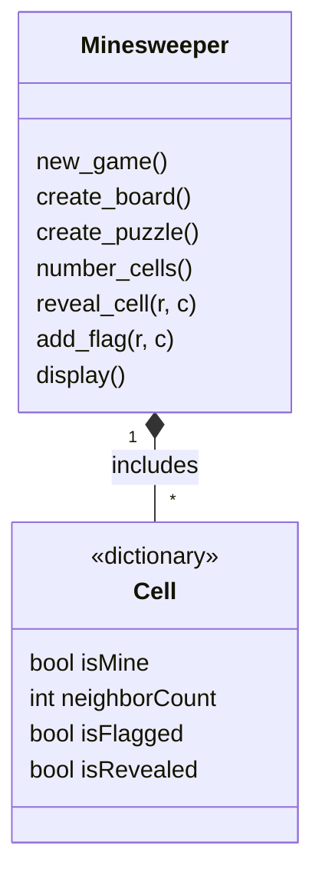
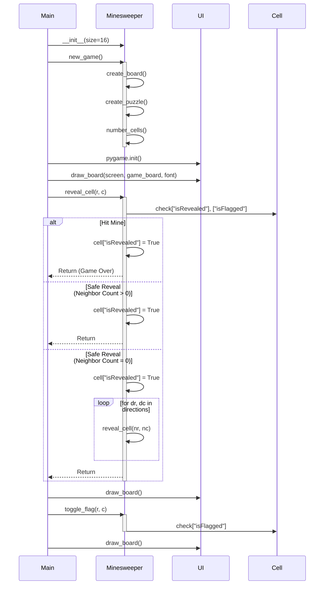

# Architecture Document

## Overview

This document describes the structure and logic of a Minesweeper game implemented in Python using Pygame. The game follows a modular architecture separating game logic from the user interface, enabling clarity, maintainability, and potential future extensions.

## Structure

The project consists of three main components:

Game Logic (Minesweeper): Handles the creation of the board, placement of mines, cell revealing, and game rules.

Cells (Cell): Represent individual squares on the board, storing mine status, neighbor counts, and flag/reveal states.

User Interface (UI): Handles rendering the board using Pygame and user interactions (left-click for reveal, right-click for flag).

## Game Logic
### Board Initialization

New Game: Resets the board.

Board Creation: Populates the board with empty Cell dictionaries.

Mine Placement: Randomly assigns mines to cells while ensuring the first clicked cell is safe.

Neighbor Count: Computes the number of adjacent mines for each non-mine cell.

### Gameplay Mechanics

Reveal Cell:

If a mine is revealed → game over.

If neighbor mine count is higher than zero, reveal only the cell.

If neighbor mine count is equal to zero, recursively reveal adjacent cells.

Toggle Flag: Marks or unmarks a cell as a suspected mine.

## Class Diagram

## Sequence Diagram

